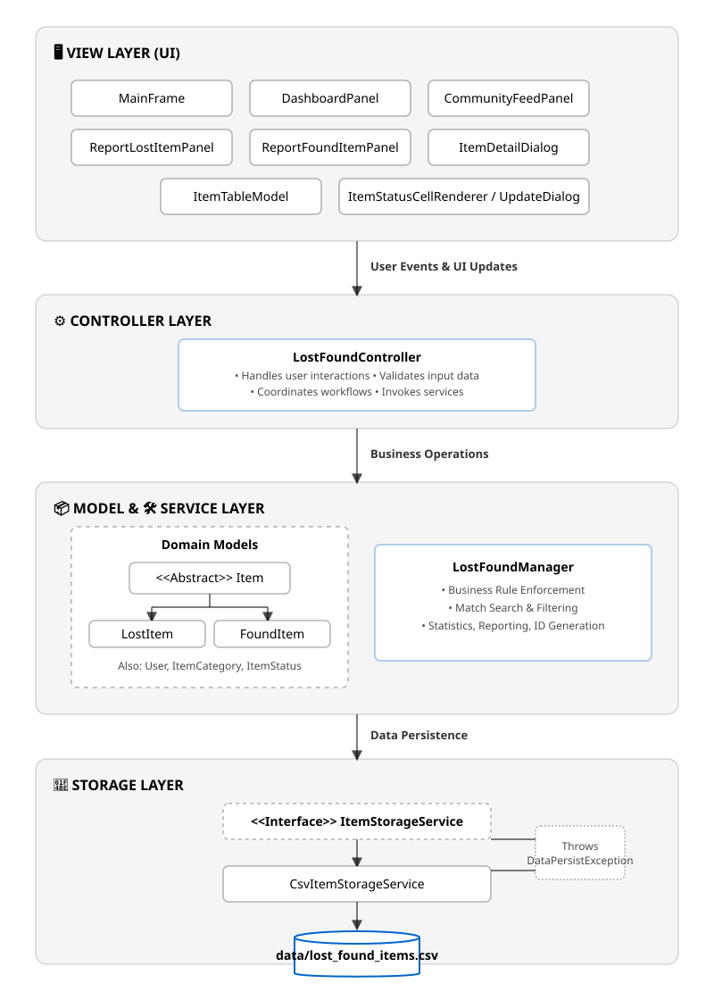

# Smart Lost &amp; Found Management System

**An Enterprise-Grade Java Desktop Application &amp; Web Feed with MongoDB Persistence**

[](https://www.oracle.com/java/)
[](https://www.mongodb.com/)
[](https://en.wikipedia.org/wiki/Swing_(Java))
[](test/com/smartlostfound/TestSuite.java)

---

## Project Overview

The **Smart Lost &amp; Found Management System** is a modular desktop and web-feed application engineered with **Java 11+, Java Swing, and MongoDB** to streamline the tracking, searching, claiming, and resolution of lost and found personal belongings.

The system features:
- **Desktop Graphical Interface**: Interactive dashboards, tabular management, image attachments, lightbox previews, and dedicated user authentication.
- **Embedded Web Feed Server**: Lightweight built-in HTTP server (`http://localhost:8080/feed`) delivering a live, responsive public community feed to web browsers.
- **MongoDB Persistence Engine**: Connects natively to cloud **MongoDB Atlas** or local MongoDB instances (`lostfound` database) with resilient local CSV fallback.
- **Role-Based Access Control (RBAC)**: Secure multi-user authentication with SHA-256 password hashing, user registration, and administrative privileges.
- **Zero-Downtime Offline Resilience**: Automatic bidirectional synchronization between remote MongoDB and local CSV caches (`data/items.csv`, `data/users.csv`).

---

## 1. Technology Stack

| Layer | Component / Technology | Description |
|---|---|---|
| **Runtime** | Java 11+ (OpenJDK / Oracle JDK) | Cross-platform core JVM environment |
| **Desktop GUI** | Java Swing &amp; Java AWT | High-performance desktop UI with custom component styling |
| **Architecture** | Model-View-Controller (MVC) | Separation of presentation, business rules, and persistence |
| **Primary Database** | MongoDB Atlas / Local MongoDB | NoSQL BSON document store (`items` and `users` collections) |
| **Fallback Storage** | RFC 4180 CSV Caching | Offline resilience with automatic failover and recovery |
| **Configuration** | `.env` Environment Loader | Unified key-value configuration via native `DotEnv` parser |
| **Embedded Web** | `com.sun.net.httpserver.HttpServer` | Read-only public community feed on port `8080` |
| **Security** | SHA-256 Hashing &amp; RBAC | Encrypted password storage, session control, user roles |
| **Testing** | Custom Automated Test Suite | 135 unit, integration, and security test cases |
| **Documentation** | JavaDoc &amp; Architecture SVG | Full API documentation and interactive SVG diagram |

---

## 2. System Architecture

The application is structured into four decoupled layers to ensure maintainability, testability, and extensibility.

### 2.1 Architectural Diagram



### 2.2 Layered Structure

```text
+-------------------------------------------------------------------------------+
|                               PRESENTATION LAYER                              |
|                                                                               |
|  [Desktop Swing Application]                    [Web Browser Client]          |
|  - MainFrame          - AuthPagePanel           - Community Feed (HTML/CSS)   |
|  - DashboardPanel     - AdminConsolePanel       - Live item status & photos   |
|  - CommunityFeedPanel - MyItemsPanel            - Embedded at :8080/feed      |
|  - ReportLostPanel    - ReportFoundPanel                                      |
|  - ItemDetailDialog   - PhotoLightboxDialog                                   |
+---------------------------------------+---------------------------------------+
                                        |
                                        | User Events & HTTP Requests
                                        v
+-------------------------------------------------------------------------------+
|                           CONTROLLER & SERVER LAYER                           |
|                                                                               |
|  LostFoundController                         WebFeedServer (port 8080)        |
|  - Event dispatching & input validation      - High-performance read-only feed|
|  - Session management & RBAC enforcement     - Image serving (/images/*)      |
+---------------------------------------+---------------------------------------+
                                        |
                                        | Business Invocations
                                        v
+-------------------------------------------------------------------------------+
|                         SERVICE & DOMAIN MODEL LAYER                          |
|                                                                               |
|  LostFoundManager                            UserManager                      |
|  - Item lifecycle & status transitions       - User authentication & sessions |
|  - Multi-criteria search & filtering         - SHA-256 password security      |
|  - Analytical statistics & ID sequence       - Role enforcement (ADMIN/USER)  |
|                                                                               |
|  Domain Models:                              Enums:                           |
|  - Item (Abstract) -> LostItem, FoundItem    - ItemCategory                   |
|  - UserAccount -> User                       - ItemStatus, UserRole           |
+---------------------------------------+---------------------------------------+
                                        |
                                        | Persistence Invocations
                                        v
+-------------------------------------------------------------------------------+
|                         STORAGE & PERSISTENCE LAYER                           |
|                                                                               |
|  DotEnv (.env Loader) & MongoConfig                                           |
|  - Loads environment settings, connection URIs, timeouts, and ports           |
|                                                                               |
|  ItemStorageService (Interface)              UserStorageService (Interface)   |
|      ^                                           ^                            |
|      +--- MongoItemStorageService                +--- MongoUserStorageService |
|      +--- CsvItemStorageService                  +--- CsvUserStorageService   |
|                                                                               |
|  +-----------------------------------+   +---------------------------------+  |
|  |     PRIMARY DATABASE (CLOUD)      |   |      OFFLINE RESILIENT CACHE    |  |
|  |   MongoDB Atlas (lostfound db)    |   |     data/items.csv              |  |
|  |   - items (BSON collection)       |   |     data/users.csv              |  |
|  |   - users (BSON collection)       |   |     Automatic offline fallback  |  |
|  +-----------------------------------+   +---------------------------------+  |
+-------------------------------------------------------------------------------+
```

---

## 3. Project Directory Structure

```text
smart-lost-found/
├── .env                              # Environment configuration (MongoDB URI, database, port)
├── .env.example                      # Configuration template for deployments
├── build.sh                          # Compilation, automated tests, JAR packaging, and JavaDocs
├── run.sh                            # Launches the Desktop GUI and Web Feed Server
├── run-server.sh                     # Runs standalone Web Feed Server in terminal/background
├── SmartLostFound.jar                # Self-contained executable Fat JAR (with bundled MongoDB drivers)
│
├── data/
│   ├── items.csv                     # Local cache of lost & found items
│   ├── users.csv                     # Local cache of user accounts & credentials
│   ├── mongodb-config.json           # Fallback JSON database configuration
│   └── images/                       # Uploaded item photographs & assets
│
├── docs/
│   ├── architecture.svg              # Scalable vector architecture diagram
│   └── (JavaDoc Documentation)       # Generated HTML API documentation
│
├── lib/
│   ├── bson-4.11.1.jar               # BSON serialization library
│   ├── mongodb-driver-core-4.11.1.jar# MongoDB core driver engine
│   └── mongodb-driver-sync-4.11.1.jar# MongoDB synchronous client driver
│
├── test/
│   └── com/smartlostfound/
│       └── TestSuite.java            # Comprehensive automated test suite (135 tests)
│
└── src/
    └── com/smartlostfound/
        ├── Main.java                 # Application entry point & headless detector
        │
        ├── controller/
        │   └── LostFoundController.java  # Mediates UI interactions, validation, & RBAC
        │
        ├── model/
        │   ├── Item.java                 # Abstract domain base class
        │   ├── LostItem.java             # Specialized lost item entity
        │   ├── FoundItem.java            # Specialized found item entity
        │   ├── User.java                 # Base contact profile
        │   ├── UserAccount.java          # Authenticated user account with role
        │   ├── UserRole.java             # Access roles (USER, ADMIN)
        │   ├── ItemCategory.java         # Item classification categories
        │   └── ItemStatus.java           # Item lifecycle statuses
        │
        ├── service/
        │   ├── LostFoundManager.java     # Item inventory, search, & business rules
        │   ├── UserManager.java          # Authentication, user registry, & security
        │   └── WebFeedServer.java        # Embedded HTTP web server for community feed
        │
        ├── storage/
        │   ├── DotEnv.java               # Native .env parser & configuration loader
        │   ├── MongoConfig.java          # MongoDB configuration parameters & resolver
        │   ├── MongoClientProvider.java  # Thread-safe MongoDB client connection pool
        │   ├── MongoItemStorageService.java # MongoDB BSON item persistence with CSV cache
        │   ├── MongoUserStorageService.java # MongoDB BSON user persistence with CSV cache
        │   ├── ItemStorageService.java   # Contract for item storage
        │   ├── UserStorageService.java   # Contract for user storage
        │   ├── CsvItemStorageService.java# RFC 4180 CSV item parser & writer
        │   ├── CsvUserStorageService.java# CSV user account parser & writer
        │   └── DataPersistenceException.java # Checked storage exception
        │
        └── view/
            ├── MainFrame.java            # Primary application window & layout
            ├── AuthPagePanel.java        # Authentication portal (Sign In / Sign Up)
            ├── DashboardPanel.java       # Tabular inventory view with search & metrics
            ├── CommunityFeedPanel.java   # Social timeline feed with comments & reactions
            ├── MyItemsPanel.java         # Current user's reported items management
            ├── AdminConsolePanel.java    # Administrator dashboard & user management
            ├── ReportLostItemPanel.java  # Lost item reporting form
            ├── ReportFoundItemPanel.java # Found item reporting form
            ├── ItemDetailDialog.java     # Detailed view dialog for individual items
            ├── UpdateStatusDialog.java   # Status transition & resolution notes dialog
            ├── PhotoLightboxDialog.java  # Fullscreen image viewer
            ├── GoogleAuthDialog.java     # Google Sign-In dialog
            ├── GuestReportAuthDialog.java# Sign-up modal prompt for guest reporters
            ├── ItemTableModel.java       # Swing table model for item collections
            ├── ItemStatusCellRenderer.java # Color-coded status badge table cell renderer
            ├── ImageHelper.java          # Image scaling, cropping, & placeholder utility
            └── UIUtils.java              # Typography, theme tokens, & custom components
```

---

## 4. Configuration (`.env`)

The system reads settings from a root [`.env`](file:///home/sabbir/Downloads/smart-lost-found/.env) file automatically at startup:

```env
# MongoDB Connection URI
# Cloud MongoDB Atlas:
MONGODB_URI=mongodb+srv://<username>:<password>@cluster3.zj8rxwz.mongodb.net/?retryWrites=true&w=majority
# Or Local MongoDB:
# MONGODB_URI=mongodb://localhost:27017

# Database & Collection Names
MONGODB_DATABASE=lostfound
MONGODB_ITEMS_COLLECTION=items
MONGODB_USERS_COLLECTION=users

# Timeout Thresholds (in milliseconds)
MONGODB_CONNECT_TIMEOUT_MS=10000
MONGODB_SERVER_SELECTION_TIMEOUT_MS=10000

# Localhost Web Feed Server Port
PORT=8080
```

---

## 5. Quick Start & Execution

### 5.1 System Prerequisites
- **Java Development Kit (JDK) 11 or higher**
- Supported operating systems: Linux, macOS, Windows

Verify Java:
```bash
java -version
javac -version
```

### 5.2 Build & Test
Build the fat JAR, execute the full test suite, and generate JavaDocs:
```bash
chmod +x build.sh run.sh run-server.sh
./build.sh
```

### 5.3 Launch the Full Application (Desktop UI + Web Server)
```bash
./run.sh
```
*(Or directly: `java -jar SmartLostFound.jar`)*

- The desktop GUI will appear on your graphical display.
- The web feed will be available in your browser at: **[http://localhost:8080/feed](http://localhost:8080/feed)**.

### 5.4 Run in Web Server Only Mode (Background / Headless)
```bash
./run-server.sh
```
*(Or directly: `java -jar SmartLostFound.jar --server`)*

---

## 6. Automated Testing

The project includes an automated test suite verifying domain logic, MongoDB serialization, CSV persistence, authentication, and HTTP endpoints:

```bash
java -cp "bin:lib/*" com.smartlostfound.TestSuite
```

### Test Coverage Summary (135 Tests, 100% Pass Rate):
1. **User Model**: Validation, encapsulation, and contact rules.
2. **Item Polymorphism**: Abstract contracts, reward logic, and custody attributes.
3. **Manager Operations**: Sequential ID generation (`LOST-1001`, `FND-2001`) and data seeding.
4. **Search & Filters**: Multi-criteria keyword, category, and type filtering.
5. **Status Lifecycle**: Transitions (`LOST` -> `RECOVERED`, `FOUND` -> `CLAIMED`).
6. **CSV Persistence**: RFC 4180 escaping, multiline text, and special characters.
7. **Table Model Integration**: Dynamic Swing table model synchronization.
8. **Controller Workflows**: Event routing and session state validation.
9. **User Roles & RBAC**: Admin privileges vs standard user boundaries.
10. **Authentication**: SHA-256 password verification and credential caching.
11. **Web Feed Security**: Route restrictions (HTTP 403 on internal paths, HTTP 200 on `/feed`).
12. **Google Sign-In**: Automatic user provisioning and profile matching.
13. **MongoDB Architecture**: BSON document round-trip serialization, configuration loading, and zero-downtime offline fallback.

---

## 7. License & Credits

- **Architecture & Development**: Smart Lost &amp; Found Engineering Team
- **Driver Integration**: MongoDB Official Java Sync Driver (v4.11.1)
- **License**: Educational / Academic Project License
